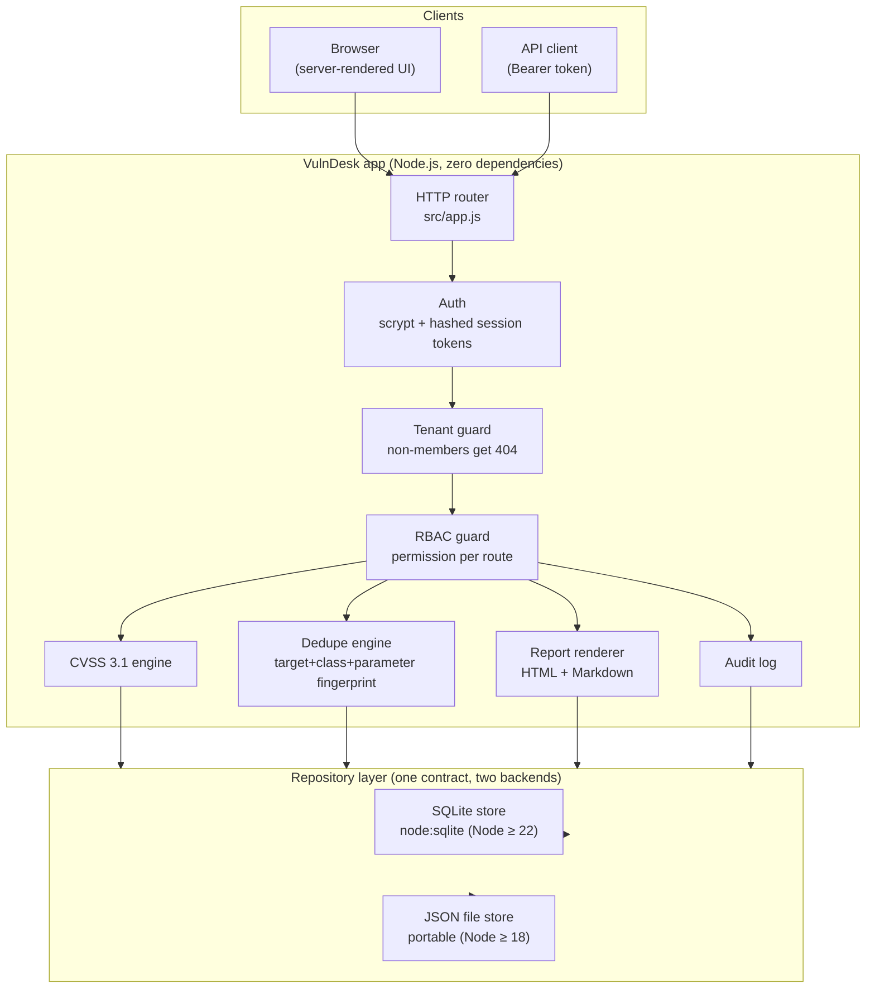

# VulnDesk

**Multi-tenant vulnerability management & bug-bounty triage — the platform layer between "a researcher submitted a report" and "engineering fixed it."**

[](https://github.com/gravion-ux/vulndesk/actions/workflows/ci.yml)


Security teams running bounty programmes drown in the same three problems: duplicate reports eating triage time, severity argued by gut feel instead of a standard, and findings scattered across spreadsheets with no audit trail. VulnDesk is built around exactly those problems:

- **A dedupe engine, not a search box.** Every finding is fingerprinted on submission from the triple that defines "the same bug" — normalised target + vulnerability class + parameter. Exact matches are flagged as likely duplicates *before* a human spends a minute on them; same-class/same-host findings are surfaced as "similar" for a triager's judgement call.
- **Real CVSS 3.1 scoring.** Severity is computed from the vector with the published FIRST equations (verified against known vectors), never typed in by hand — so a 9.8 means the same thing on every programme.
- **Tenancy you can prove.** Workspaces are isolated in the data layer itself: every query is tenant-scoped, and a finding id from one workspace simply does not exist in another. The test suite attacks this directly.
- **Zero runtime dependencies.** Plain Node.js, a real repository layer with two interchangeable backends, server-rendered dashboard plus a JSON REST API. It runs anywhere Node ≥ 18 runs — including a $5 VPS and this repo's Docker image.

---

## Screenshots

> _Placeholders — drop PNGs into `docs/screenshots/` and update the paths._

| Dashboard | Finding & report |
| --- | --- |
|  |  |

| Findings queue | Dedupe flag |
| --- | --- |
|  |  |

---

## Features

- **Workspaces (tenants)** — create any number of organisations; membership is per-workspace.
- **Authentication** — scrypt-hashed passwords, opaque session tokens (only hashes stored server-side), cookie + bearer auth, 7-day sessions, server-side logout invalidation.
- **RBAC** — `owner / admin / analyst / viewer` roles with a named-permission matrix enforced on *every* route. Viewers are read-only; analysts triage but cannot manage members; the owner role cannot be granted, re-roled or removed.
- **Programmes** — bounty programmes per workspace with platform, scope text and status.
- **Findings lifecycle** — `new → triaged → accepted → duplicate → informative → fixed` with a validated transition map (no jumping `new → fixed`), assignment to workspace members, and list filters by status, severity, programme and assignee.
- **CVSS 3.1 engine** — full base-score equations including scope-changed PR weights and the Appendix-A round-up; severity bands derived from the score.
- **Dedupe engine** — SHA-256 fingerprints over (normalised target, class, parameter); exact-match flagging on submission, "similar" surfacing, and dedupe provenance in every report. Comparisons never cross a tenant boundary.
- **Professional reports** — each finding renders as a clean report (metadata table, description, reproduction, impact, remediation) in the browser and as a downloadable Markdown export.
- **Dashboard & stats** — counts by severity and status, per-programme totals and open counts, recent findings, recent activity; the same numbers via `GET /api/workspaces/:id/stats`.
- **Audit log** — every mutating action (creates, status changes, assignments, membership changes…) recorded per workspace and readable by owners/admins.
- **Dual storage backends** — SQLite (`node:sqlite`) on Node ≥ 22, portable JSON-file store on older Nodes, behind one repository contract with a shared conformance suite.

## Architecture



**Request path:** session resolution → tenant resolution (membership or 404) → permission check → domain logic (CVSS scoring, dedupe assessment, lifecycle validation) → store → audit entry for every mutation.

## Quickstart

### Local (Node ≥ 18)

```bash
git clone https://github.com/gravion-ux/vulndesk.git
cd vulndesk

# Optional: seed a demo workspace (3 users, 2 programmes, 12 findings)
npm run seed

npm start
# → http://localhost:3000
```

Demo accounts after seeding (local use only — change before any real deployment):

| Role | Email | Password |
| --- | --- | --- |
| Owner | `owner@vulndesk.local` | `OwnerPass#2026` |
| Analyst | `analyst@vulndesk.local` | `AnalystPass#2026` |
| Viewer | `viewer@vulndesk.local` | `ViewerPass#2026` |

### Docker

```bash
docker compose up --build
# → http://localhost:3000  (data persists in the vulndesk-data volume)

# Seed the demo workspace inside the container:
docker compose exec vulndesk node scripts/seed.js
```

### Configuration

| Variable | Default | Purpose |
| --- | --- | --- |
| `PORT` | `3000` | Listen port |
| `HOST` | `0.0.0.0` | Bind address |
| `VULNDESK_DB` | `data/vulndesk.sqlite` | Database file path |
| `VULNDESK_STORE` | auto | Force `sqlite` or `json` backend |
| `VULNDESK_SECURE_COOKIES` | unset | Set `1` behind HTTPS to mark session cookies `Secure` |

## API at a glance

All API routes are JSON. Authenticate with the session cookie or `Authorization: Bearer <token>`.

| Area | Endpoints |
| --- | --- |
| Auth | `POST /api/auth/register` · `POST /api/auth/login` · `POST /api/auth/logout` · `GET /api/me` |
| Workspaces | `POST/GET /api/workspaces` · `GET/PATCH/DELETE /api/workspaces/:id` |
| Members | `GET/POST /api/workspaces/:id/members` · `DELETE /api/workspaces/:id/members/:userId` |
| Programmes | `GET/POST /api/workspaces/:id/programmes` · `GET/PATCH/DELETE …/programmes/:pid` |
| Findings | `GET/POST /api/workspaces/:id/findings` (filters: `status`, `severity`, `programmeId`, `assigneeId`) · `GET/PATCH/DELETE …/findings/:fid` · `POST …/findings/:fid/status` · `POST …/findings/:fid/assign` |
| Reports | `GET /api/workspaces/:id/findings/:fid/report.md` |
| Stats & audit | `GET /api/workspaces/:id/stats` · `GET /api/workspaces/:id/audit` |

Creating a finding returns the finding **plus** its dedupe assessment:

```json
{
  "id": "fnd_…",
  "severityScore": 9.8,
  "severityBand": "critical",
  "status": "new",
  "dedupe": { "fingerprint": "…", "possibleDuplicateOf": null, "similar": [] }
}
```

## Security model

- **Tenant isolation in the data layer.** Every store method for workspace-owned data takes a `workspaceId` and scopes by it (SQL `WHERE workspace_id = ?`, equivalent filtering in the JSON backend). Route handlers resolve membership first; non-members receive **404**, so workspace existence is not leaked.
- **RBAC on every route.** Permissions are named (`findings.triage`, `members.manage`, …) and checked explicitly per route — there are no "assumed admin" paths. The conformance and RBAC suites test denials for each role.
- **Passwords** are hashed with scrypt (per-user salt, constant-time verify). Plaintext is never stored or logged.
- **Sessions** are 256-bit random tokens; only their SHA-256 hashes are stored, so a database leak does not yield usable sessions. Cookies are `HttpOnly` + `SameSite=Lax` (plus `Secure` when configured).
- **Severity integrity.** Clients submit a CVSS vector; the score and band are always computed server-side.
- **Auditability.** Every mutation writes an audit entry with actor, action, entity and detail.
- **Output safety.** All user-controlled strings are HTML-escaped in server-rendered views.
- **Known limits (honest list):** no rate limiting or account lockout yet, no email verification or password reset flow, no CSRF tokens (mitigated partially by `SameSite=Lax` cookies; bearer-token API use is unaffected), and the JSON backend is single-process. See the roadmap.

## Development

```bash
npm test   # 61 tests, node:test — no install step, no dependencies
```

The suite covers: password/session auth, RBAC denials per role, cross-tenant isolation attacks, dedupe flagging and normalisation, lifecycle transition rules, assignment rules, CVSS anchor vectors, report rendering (HTML + Markdown), dashboard/stats correctness, an end-to-end run on the SQLite backend, and a store-conformance suite that runs the same contract against every backend.

CI (GitHub Actions) runs the suite on Node **18, 20 and 22** — the JSON backend covers 18/20, the SQLite backend is exercised on 22.

## Roadmap

- [ ] Email flows: verification, password reset, member invitations by email
- [ ] Rate limiting, login throttling and optional TOTP 2FA
- [ ] Researcher-facing submission portal (public programme pages, API keys for intake)
- [ ] Webhooks + Slack/email notifications on status changes
- [ ] Reward tracking: bounty amounts, payout status, per-researcher leaderboards
- [ ] CVSS 4.0 scoring alongside 3.1
- [ ] Fuzzy dedupe v2: text-similarity scoring on titles/descriptions
- [ ] Postgres backend for multi-process deployments
- [ ] Bulk import (CSV / HackerOne & Bugcrowd export formats)
- [ ] SLA timers per severity band with breach alerts

## License

MIT © [Priyanshu Kumar Thakur](https://github.com/gravion-ux) — see [LICENSE](LICENSE).
